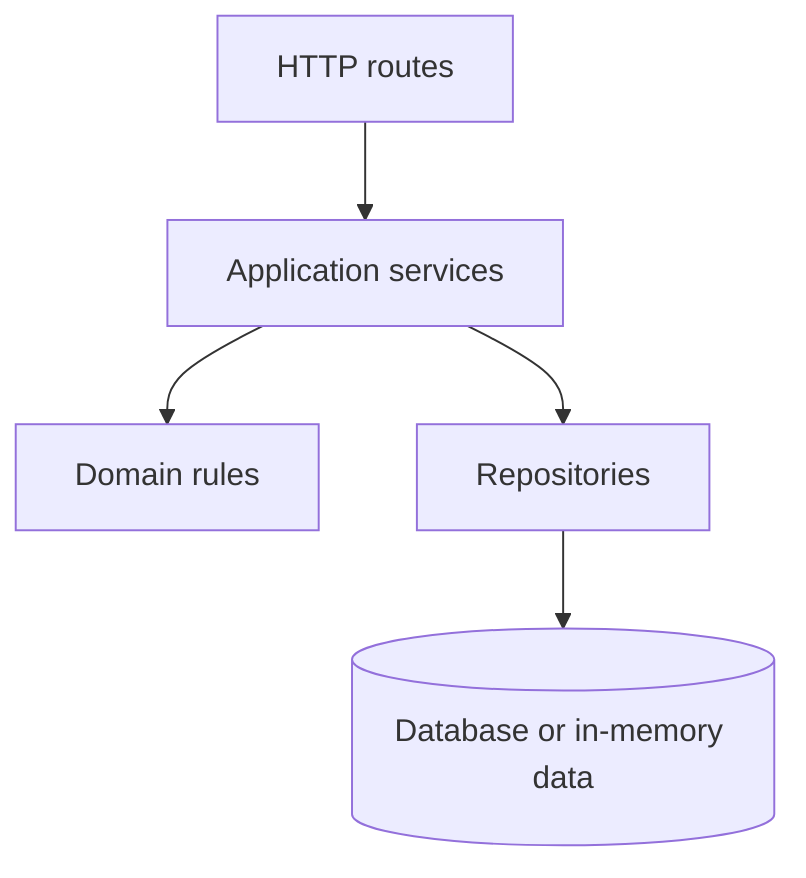
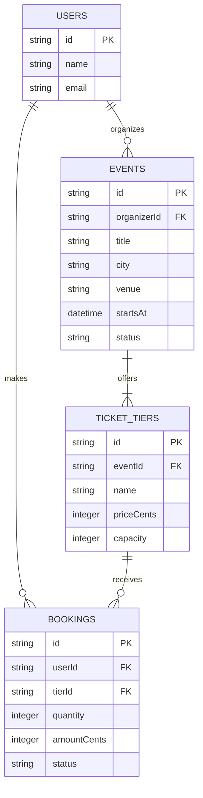
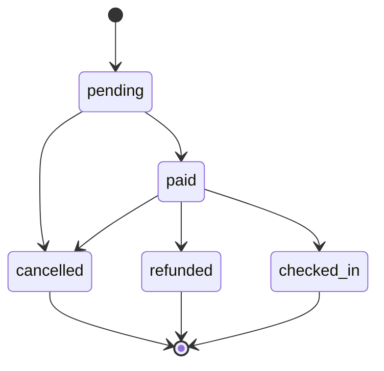

# Build 3 architecture

## Layers

- **Routes** may read HTTP input, call services and format responses; they may not contain business rules or access data directly.
- **Services** may coordinate rules and repositories; they may not depend on HTTP details or call routes.
- **Rules** may validate and transform domain data; they may not perform I/O or depend on outer layers.
- **Repositories** may read and write data; they may not decide business policy or call services, routes or rules.
- **Data** is persisted state; it does not call application layers.

## Data model

## Booking life cycle

`cancelled`, `refunded` and `checked_in` are final states. A booking may be cancelled while pending or paid; a paid booking may also be refunded or checked in.
